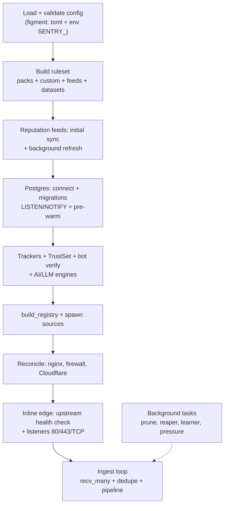

# Daemon Lifecycle

The daemon (`sentry run`, wiring in
[`daemon.rs`](https://github.com/IDjinn/sentry/blob/main/crates/sentry-cli/src/daemon.rs#L148))
assembles everything in dependency order: contracts first, shared state
next, sources and background tasks last. Optional infrastructure failures
(Postgres, geo, feeds, DNS) degrade with `warn!` instead of aborting;
configuration failures (invalid policy, malformed `[real_ip]`, TLS without
the feature) abort with a readable error.

## Startup sequence

1. **Config** — `sentry.toml` + `SENTRY_*` overlay; `ActionKind` and
   `ChallengeBackend` are typed enums, so config typos fail at load.
   Protocol schemas are also compiled here (F9; a failed compile keeps the
   previous set).
2. **Ruleset** ([`packs.rs`](https://github.com/IDjinn/sentry/blob/main/crates/sentry-core/src/packs.rs)) —
   default packs with `shadow`/`enforce` modes (params flatten to
   `<pack>__<param>`), `[[rules.custom]]` rules, one synthetic rule per
   feed with an `action`, and dataset rules (`feed:<name>`).
3. **Reputation feeds** (F3.7) — initial sync with a 120 s timeout, summary
   in the log, background refresh; a failing feed keeps its previous
   entries.
4. **Geo** ([`sentry-geo`](https://github.com/IDjinn/sentry/blob/main/crates/sentry-geo/)) —
   opens MaxMindDB; without the databases, enrichment stays off (no-op).
5. **Postgres** ([`sentry-storage`](https://github.com/IDjinn/sentry/blob/main/crates/sentry-storage/)) —
   connect + migrations + three LISTEN tasks (rules, blocks, datasets) +
   DB dataset rules applied + **block table pre-warm** from
   `ip_state.blocked()` and **offender tracker pre-warm** from persisted
   strikes (a returning offender past the TTL re-blocks on the 1st event).
   Without a configured URL, the daemon runs without persistence.
6. **Trackers and guards** — scan, behavior, upload flood, posture,
   correlation, offender ([`pipeline.rs`](https://github.com/IDjinn/sentry/blob/main/crates/sentry-core/src/pipeline.rs));
   the [`TrustSet`](https://github.com/IDjinn/sentry/blob/main/crates/sentry-core/src/trust.rs)
   (embedded Cloudflare ranges + daily refresh + trusted list presets);
   the bot rDNS-verification worker (F7.7) off the hot path.
7. **Routes** — validator merges config ∪ DB (`RouteValidator::merge`);
   with no configured routes, every path generates `UnknownRoute` (explicit
   warn).
8. **Registry + sources** —
   [`build_registry`](https://github.com/IDjinn/sentry/blob/main/crates/sentry-cli/src/daemon.rs#L3189)
   instantiates the actions (`[[action]]`) and the sources (`[[source]]`)
   are spawned, publishing into the fan-in.
9. **Infrastructure reconcile** — nginx deny includes against `ip_state`
   (F7.8), kernel/firewall ban sync from the DB (60 s loop, F7.3),
   Cloudflare reconcile on startup (verify token, adopt live rules, delete
   expired, provision /64 IP Lists — F2.5/F2.14).
10. **Inline edge** (when `mode = "inline"`) —
    [`proxy::serve`](https://github.com/IDjinn/sentry/blob/main/crates/sentry-edge/src/proxy.rs#L158)
    runs the **mandatory upstream health check** before accepting traffic
    (startup fails if the backend does not answer), then starts the port
    80 listener, TLS 443 (feature `edge-tls`) and the optional edge-tcp.
11. **Metrics server** — `/metrics` + `/api/events`
    ([`metrics.rs`](https://github.com/IDjinn/sentry/blob/main/crates/sentry-cli/src/metrics.rs))
    when `[metrics] enabled`.
12. **Ingest loop** — `recv_many(64)` on the fan-in, LRU dedupe,
    `pipeline.process`, inline forks, telemetry/action lanes.

## Background tasks

| Task | Interval | Role |
| --- | --- | --- |
| Tracker prunes (offender, scan, behavior, upload, correlation, posture, BlockTable, rate limiter) | 60 s | Expire per-IP windows and block entries |
| [`prune_pending`](https://github.com/IDjinn/sentry/blob/main/crates/sentry-core/src/pipeline.rs#L770) | 60 s | Drop expired response-phase signals (F3.9.1) |
| Pressure monitor | 5 s | Queue occupancy + INSERT latency (EMA) → flips `OverloadState` |
| Persist worker | continuous | Batches of up to 64 events per multi-INSERT |
| Action workers | continuous | Execute deferred (network) actions; 1 worker = strict ordering |
| Cloudflare reaper | 300 s | Deletes access rules/IP List entries whose `sentry:<ts>:<ttl>` TTL expired |
| Route learner | `[route_learner] interval_secs` | Infers route shapes and publishes via NOTIFY |
| Cloudflare range refresh (`[real_ip]`) | daily | Updates the `TrustSet` |
| Protocol watcher (F9) | 500 ms debounce + 60 s safety poll | Recompiles schemas on fs events |
| Feed refresh | per feed | Re-fetches reputation/dataset feeds |

## Hot-reload via LISTEN/NOTIFY

Shared state between nodes and between CLI/dashboard and daemon travels
over Postgres channels ([`PgPool`](https://github.com/IDjinn/sentry/blob/main/crates/sentry-storage/src/pool.rs)):

| Channel | Listener | Effect |
| --- | --- | --- |
| `sentry_rules_changed` | `rules_hot_reload` | Reloads the `RuleSet` from the DB and hot-swaps it |
| `sentry_blocks_changed` | `blocks_hot_reload` | Updates the `BlockTable` — a block on one node denies on every node's edge |
| `sentry_datasets_changed` | `datasets_hot_reload` | Replaces `dataset:<name>` rules and dynamic prefilter literals (F7.7) |
| `sentry_routes_changed` | `routes_hot_reload` | Merges config ∪ DB and swaps the validator (learner + `sentry routes`) |
| `sentry_model_changed` | model reload loop | Swaps the ONNX model hot with the `AiFork` in `Arc<RwLock<>>` (F3.6) |

Emitters: CLI commands (`sentry rules`, `sentry model reload`,
`sentry routes`, `sentry ip block/unblock`), the dashboard (`serve`) and
the daemon itself (block mirror).

## Shutdown

There is no explicit graceful drain: the ingest loop runs while producers
exist, and the process terminates on an OS signal (`SIGINT`/`SIGTERM`).
Durability comes from the in-memory-stateless / Postgres-stateful design:
blocks, strikes, incidents and events live in the database and are
**re-warmed on the next startup** (block table and offender tracker
pre-warm), so an abrupt death loses no security posture. Idempotent
background tasks (reaper, reconcile, learner) simply restart.
