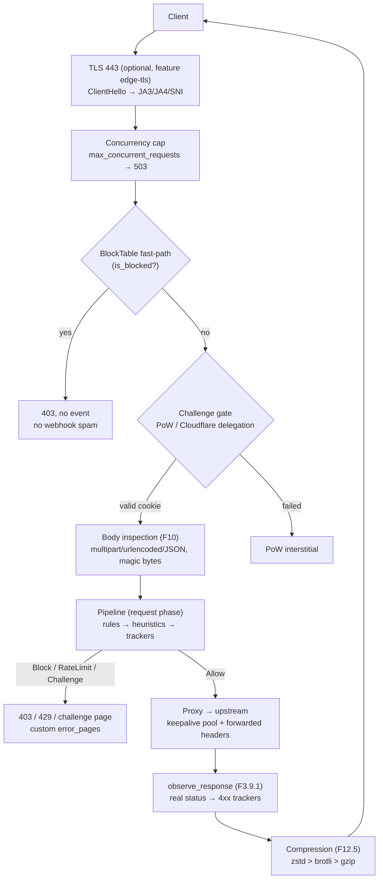

# Inline Edge

With `[deployment] mode = "inline"` Sentry stops being an observer and
becomes the **application front**: an axum reverse proxy
([`sentry-edge/src/proxy.rs`](https://github.com/IDjinn/sentry/blob/main/crates/sentry-edge/src/proxy.rs))
that inspects every request **before** the upstream and enforces the
verdict immediately. The proxy runs the same `Arc<Pipeline>` as passive
sources (trackers never double-count) and hands finished events
(`Incoming::Processed`) to the daemon.

## Mandatory health check and reverse proxy

Startup fails if the upstream does not answer the health check
(`health_path`, default `/`, timeout `health_timeout_secs` = 5 s) — the
edge never comes up "protecting" a dead backend. The edge→upstream hop is
tuned (F12.6): `connect_timeout` 5 s, a keepalive pool with
`upstream_pool_idle` = 32 connections per host (idle 90 s, TCP keepalive
60 s) and `tcp_nodelay` — **zero TCP handshake per request** on the
internal hop.

## Block fast-path (BlockTable)

The [`BlockTable`](https://github.com/IDjinn/sentry/blob/main/crates/sentry-core/src/blocks.rs)
is a shared `HashMap<IpAddr, Option<Instant>>`. The edge (proxy,
middleware, edge-tcp and the TLS acceptor) consults `is_blocked` **before**
any processing: a blocked IP gets an immediate 403, with no event and no
pipeline pass — no webhook spam, O(1) cost.

- Block verdicts from the pipeline are mirrored to `ip_state` (Postgres)
  with `NOTIFY sentry_blocks_changed`; startup pre-warm and per-node LISTEN
  make a block applied anywhere deny on every node's edge
  ([`daemon.rs`](https://github.com/IDjinn/sentry/blob/main/crates/sentry-cli/src/daemon.rs)).
- The never-ban guard (`[real_ip] trusted_ips`) applies to the fast-path
  too.
- Metrics: `sentry_edge_block_hits_total`, `sentry_block_table_size`.

## Verdict → HTTP

| Verdict | Response |
| --- | --- |
| Block | 403 (customizable page) |
| RateLimit | 429 with `Retry-After` |
| Challenge | PoW interstitial (`sentry` backend) or Cloudflare rule (`cloudflare` backend) |
| Allow | proxy to the upstream |

Every edge-generated page (403/429/challenge/413/502/301) goes through the
[`ErrorPages`](https://github.com/IDjinn/sentry/blob/main/crates/sentry-edge/src/pages.rs)
map (F12.1): `[edge.error_pages] dir` with `<status>.html` +
`default.html`, UTF-8, 256 KiB/file cap, `{{SENTRY_STATUS}}`,
`{{SENTRY_TITLE}}`, `{{SENTRY_MESSAGE}}`, `{{SENTRY_TRACE_ID}}`,
`{{SENTRY_ICON}}` placeholders with HTML escaping. Trace ID always (header
`x-sentry-trace-id` + log).

## JavaScript proof-of-work challenge (F7.11)

`[edge.challenge] enabled = true` swaps the Challenge response for a
stateless SHA-256 PoW interstitial
([`challenge.rs`](https://github.com/IDjinn/sentry/blob/main/crates/sentry-edge/src/challenge.rs)):

- `challenge_id = SHA-256(secret || ip || bucket)`; buckets of
  `bucket_secs` (default 3600) with one bucket of grace — the `sentry_ch`
  cookie survives rotation.
- Secret via env (`secret_env`, default `SENTRY_EDGE_CHALLENGE_SECRET`) —
  required when enabled; share it across edge nodes.
- `difficulty` default 16; no-CDN page, optional `template_path` with
  hot-read.
- PoW never unlocks a Block; responses are 503 with `Retry-After`.
- Crawlers verified by rDNS (F7.7) pass without solving.

## Inline TLS with ClientHello telemetry (F8)

The `edge-tls` feature ([`tls.rs`](https://github.com/IDjinn/sentry/blob/main/crates/sentry-edge/src/tls.rs)):
the acceptor *peeks* the ClientHello **before** the rustls handshake,
parses SNI/ciphers/extensions
([`clienthello.rs`](https://github.com/IDjinn/sentry/blob/main/crates/sentry-edge/src/clienthello.rs))
and feeds the pipeline one `TlsHandshake` event (SNI + JA3 + JA4) per
connection. The BlockTable fast-path denies before the handshake.

- ALPN `h2` + `http/1.1` with HTTP/2 served on the same router
  (`[edge] http2`, default true); metric `sentry_edge_tls_alpn_total{alpn}`.
- `tls_allowed_hosts` — a missing/unknown SNI (the 443 honeypot) becomes
  the `TlsSniMismatch` signal (weight 20); a post-handshake
  Block/Quarantine drops the connection.
- `tls_redirect_https` answers 301 on port 80 **after** the pipeline —
  HTTP traffic keeps being monitored and blocked.
- Gauge `sentry_edge_tls_cert_not_after` with a warn when the certificate
  expires within 14 days.

## Upload and body inspection (F10)

`[uploads] enabled = true` (opt-in, requires inline) turns on body
analysis before the proxy: multipart RFC 7578, urlencoded and JSON
([`multipart.rs`](https://github.com/IDjinn/sentry/blob/main/crates/sentry-core/src/multipart.rs),
[`uploads.rs`](https://github.com/IDjinn/sentry/blob/main/crates/sentry-core/src/uploads.rs)).

- `inspect_kb` (default 4096 = 4 MiB) bounds the per-request buffer; the
  memory ceiling is ~concurrency × `inspect_kb` — hence the concurrency
  cap.
- A body larger than the cap follows the `oversize` policy: `reject` (413),
  `skip` (forward without parsing) or `flag` (forward + `UploadOversize`
  signal, weight 20 + counts toward the flood window).
- Signals: `UploadTypeMismatch` (30), `UploadPolyglot` (60),
  `UploadExecutable` (50), `UploadFlood` (25), `UploadDisallowed` (30,
  from the `allowed_extensions` allowlist). `mode = "shadow"` zeroes the
  weights — detect without blocking.
- SQLi/XSS in filenames and form fields re-emit the known HTTP signals, so
  existing dashboards and rules work for free.

## Web security posture (F11)

[`posture.rs`](https://github.com/IDjinn/sentry/blob/main/crates/sentry-core/src/posture.rs)
evaluates the **upstream response** headers (never edge-generated pages)
and attaches `PostureAdvisory` findings with a **locked weight of 0**:
`csp`, `hsts`, `coop`, `clickjacking`, `trusted_types`, `nosniff`,
`referrer_policy` — each disableable via `[posture] checks`. Dedupe per
(host, check) with a 1 h TTL, 64-host cap. Metric
`sentry_posture_findings_total{check, host}`; report via `sentry posture`.
`mode = "enforce"` is rejected at load (header injection is roadmap).

## Response compression (F12.5)

[`compression.rs`](https://github.com/IDjinn/sentry/blob/main/crates/sentry-edge/src/compression.rs) —
one middleware covers upstream responses and edge pages on both listeners.
Bodies are already buffered → synchronous re-encode with an exact
`content-length`.

- `Accept-Encoding` negotiation with preference **zstd > brotli > gzip**
  (zstd behind the `edge-zstd` feature; brotli/gzip are pure Rust and
  always built). Levels: `level_br` 4, `level_gzip` 6, `level_zstd` 3.
- Never compressed: `content-encoding` already present,
  206/`content-range`, `no-transform`, body smaller than `min_length`
  (256),
  content types outside the allowlist (`gzip_types` semantics;
  `text/event-stream` excluded) and payloads that would not shrink.
  `Vary: Accept-Encoding` always added for candidates.
- Under overload (the shared `OverloadState` flag) compression turns
  itself off. Metric `sentry_edge_compressed_total{algo}`.

## Forwarded headers and upstream hop (F12.6/7)

`[edge] forwarded_headers = true` (default): the edge strips the client's
`X-Forwarded-*`/`X-Real-IP` and sets its resolved view —
`X-Forwarded-For`/`X-Real-IP` = client IP (§8.1 precedence),
`X-Forwarded-Proto` = real scheme (via the `TlsTerminated` extension,
never a spoofable header), `X-Forwarded-Host` = original Host. The backend
nginx keeps `real_ip`/vhost working without spoofing. Topology advisories
(`edge_advisories()`): double TLS with an `https://` upstream, and an
unencrypted hop to an off-loopback upstream.

## Concurrency cap

`[edge] max_concurrent_requests` (default **1024**, 0 = unlimited): every
in-flight request buffers up to the inspection/forward cap in memory, so a
connection flood multiplies that cost. Past the cap, requests get an
immediate 503 (with the customizable error pages) instead of being
buffered — memory stays bounded by design.
