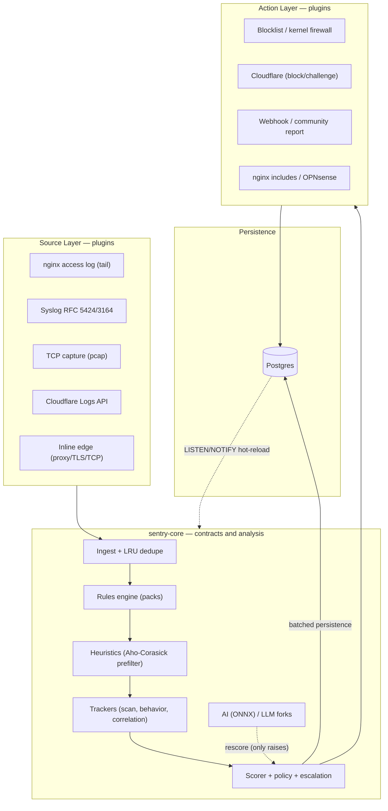

# High-Level Architecture

Sentry is a Cargo workspace organized in **three plugin layers** (Sources,
Core, Actions) on top of a Postgres persistence layer. Sources produce
normalized events; the core analyzes and decides; actions execute the
decision. Every plugin implements a common trait, so new sources and
actions never require changing the core.

## Design principles

1. **Event modular via `ProtocolData`**: a single
   [`Event`](https://github.com/IDjinn/sentry/blob/main/crates/sentry-core/src/event.rs)
   independent of origin. Protocol specifics live in the
   [`ProtocolData`](https://github.com/IDjinn/sentry/blob/main/crates/sentry-core/src/event.rs#L396)
   enum — never as loose top-level fields.
2. **Plugins depend only on the core**: every `sentry-source-*` /
   `sentry-action-*` crate implements the
   [`Source`](https://github.com/IDjinn/sentry/blob/main/crates/sentry-core/src/source.rs)
   / [`Action`](https://github.com/IDjinn/sentry/blob/main/crates/sentry-core/src/action.rs)
   traits and depends only on `sentry-core`, never on another plugin.
3. **Pure core**: `sentry-core` does no heavy I/O (no HTTP, no DB). It
   defines contracts — rules, heuristics, scorer, trackers, pipeline.
4. **Provider-agnostic edge actions**: the
   [`ChallengeProvider`](https://github.com/IDjinn/sentry/blob/main/crates/sentry-core/src/challenge.rs)
   trait mirrors `LlmProvider`; the verdict filter lives in the core, the
   provider only implements `apply`. Adding AWS WAF/Fastly changes no
   rules and no pipeline.
5. **Heavy features are optional**: ONNX (`onnx`), TLS (`edge-tls`), zstd
   (`edge-zstd`), pcap and redis sit behind feature flags that are off by
   default.
6. **Declarative configuration**: `sentry.toml` + env overlay (`SENTRY_*`)
   via figment, validated at load time (typos in `type = "..."` fail at
   load).

## Crate map (workspace)

| Crate | Purpose |
| --- | --- |
| [`sentry-core`](https://github.com/IDjinn/sentry/blob/main/crates/sentry-core/) | Pure: `Event`/`ProtocolData`, traits, rules engine + DSL, heuristics, scorer, trackers (scan/behavior/correlation/offender), pipeline, config, posture, botverify, BlockTable |
| [`sentry-storage`](https://github.com/IDjinn/sentry/blob/main/crates/sentry-storage/) | Postgres via sqlx: 5 repos (events/incidents/ip_state/rules/routes), migrations, `LISTEN/NOTIFY` |
| [`sentry-ai`](https://github.com/IDjinn/sentry/blob/main/crates/sentry-ai/) | `ThreatModel` trait (ONNX via ort) + `LlmProvider` trait (OpenRouter, Ollama, …) + external IP lookup |
| [`sentry-geo`](https://github.com/IDjinn/sentry/blob/main/crates/sentry-geo/) | Geo/ASN enrichment with maxminddb (graceful no-op without the databases) |
| [`sentry-reputation`](https://github.com/IDjinn/sentry/blob/main/crates/sentry-reputation/) | Reputation feeds (Tor/Spamhaus/FireHOL) with an SSRF-guarded fetcher |
| [`sentry-protocol`](https://github.com/IDjinn/sentry/blob/main/crates/sentry-protocol/) | Protocol description/validation DSL (F9): schema → compiler → VM (optional `simd` feature) |
| [`sentry-edge`](https://github.com/IDjinn/sentry/blob/main/crates/sentry-edge/) | Inline edge: axum reverse proxy, edge-tcp, TLS 443 with JA3/JA4 telemetry (F8), PoW challenge, compression, error pages |
| [`sentry-source-nginx`](https://github.com/IDjinn/sentry/blob/main/crates/sentry-source-nginx/) | Source plugin: access.log tail with real-IP resolution (§8.1) and rotation |
| [`sentry-source-syslog`](https://github.com/IDjinn/sentry/blob/main/crates/sentry-source-syslog/) | Source plugin: RFC 5424/3164 syslog receiver (UDP/TCP, RFC 6587 framing) |
| [`sentry-source-cloudflare`](https://github.com/IDjinn/sentry/blob/main/crates/sentry-source-cloudflare/) | Source plugin: CF Logs API polling (NDJSON), dedupe by RayID |
| [`sentry-source-tcp`](https://github.com/IDjinn/sentry/blob/main/crates/sentry-source-tcp/) | Source plugin: TCP capture behind the `pcap` feature; MuonFP/p0f-style SYN fingerprinting lives in the core (`tcpfp.rs`) |
| [`sentry-action-cloudflare`](https://github.com/IDjinn/sentry/blob/main/crates/sentry-action-cloudflare/) | Edge action: block/challenge via the CF API (access rules + /64 IP Lists), reconcile and reaper |
| [`sentry-action-webhook`](https://github.com/IDjinn/sentry/blob/main/crates/sentry-action-webhook/) | Action: Discord/Slack/etc alerts with HMAC signature |
| [`sentry-action-blocklist`](https://github.com/IDjinn/sentry/blob/main/crates/sentry-action-blocklist/) | Action: in-memory local blocklist (mirrors into the shared `BlockTable`) |
| [`sentry-action-firewall`](https://github.com/IDjinn/sentry/blob/main/crates/sentry-action-firewall/) | Action: kernel bans nftables/ipset/firewalld synced from `ip_state` (Linux-only) |
| [`sentry-action-opnsense`](https://github.com/IDjinn/sentry/blob/main/crates/sentry-action-opnsense/) | Action: OPNsense (alias_util REST) and pfSense (`pfctl`) bans |
| [`sentry-action-nginx`](https://github.com/IDjinn/sentry/blob/main/crates/sentry-action-nginx/) | Action: deny/challenge includes for nginx + reload with `nginx -t` |
| [`sentry-action-report`](https://github.com/IDjinn/sentry/blob/main/crates/sentry-action-report/) | Action: community reporting to AbuseIPDB/ReportedIP with dedupe and circuit breaker |
| [`sentry-cli`](https://github.com/IDjinn/sentry/blob/main/crates/sentry-cli/) | Binary: daemon + wiring, HTTP server (`serve`), ratatui TUI, auth/RBAC, SIEM export, service mode, CLI commands |

## Workspace conventions

- Shared dependencies live in `[workspace.dependencies]` in the root
  `Cargo.toml`; each crate references them via `{ workspace = true }`.
- `sentry-core` is **pure** (`#![forbid(unsafe_code)]` in every lib) — no
  network or database I/O; the daemon (`sentry-cli`) does the wiring.
- Adding a new protocol: new `ProtocolData` variant + helper on
  `impl Event` + `protocol_kind()` update. Details on the
  [Data Model](/en/architecture/data-model) page.
- Adding a new edge provider (AWS WAF, Fastly…): new crate implementing
  `ChallengeProvider` + an arm in the daemon's `build_challenge_action`
  match — no `ActionKind`, rule or pipeline changes.

## Next steps

- [Data Model](/en/architecture/data-model) — `Event`, `ProtocolData`, `UploadInfo`
- [Request Flow](/en/architecture/request-flow) — the pipeline in order, for both ingestion modes
- [Risk Levels](/en/architecture/risk-levels) — signal weights, verdicts, escalation
- [Daemon Lifecycle](/en/architecture/daemon-lifecycle) — startup, background tasks, hot-reload
- [Inline Edge](/en/architecture/edge-inline) — proxy, TLS, challenge, uploads, compression
- [Performance](/en/architecture/performance) — benchmark numbers, two-lane hot path, overload
