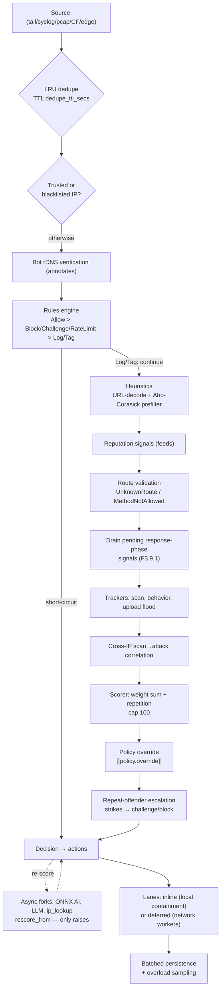
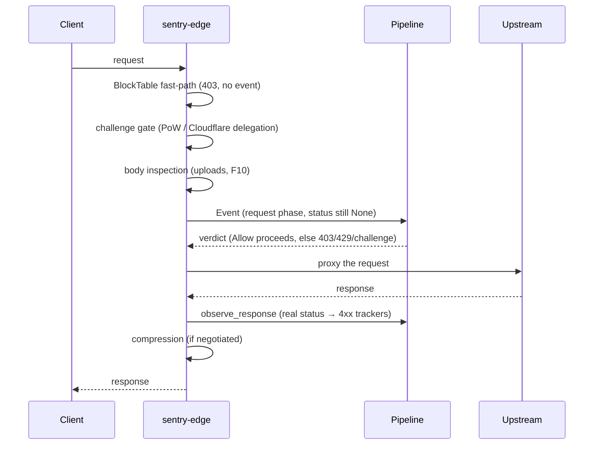

# Request Flow

Sentry operates in two ingestion modes, set by `[deployment] mode`:

- **Passive** (default): read-only sources tail logs / receive syslog /
  capture packets. The pipeline analyzes the event and actions react
  (block on Cloudflare/firewall, webhook, …) — the request already
  happened.
- **Inline** (`sentry-edge`): Sentry is the reverse proxy in front of the
  application. Each request goes through the **same** `Arc<Pipeline>`
  **before** the upstream; the verdict decides whether it proceeds (and
  the response phase is re-observed — see below).

## Stages in detail

1. **Ingest + dedupe** — the daemon loop drains the fan-in in batches
   (`recv_many(64)`) and consults an LRU keyed by the event's `u64` hash;
   identical GETs within `dedupe_ttl_secs` (10 s) die before the pipeline.
   See [`daemon.rs`](https://github.com/IDjinn/sentry/blob/main/crates/sentry-cli/src/daemon.rs).
2. **Trust guards** ([`trust.rs`](https://github.com/IDjinn/sentry/blob/main/crates/sentry-core/src/trust.rs)) —
   IPs in `trusted_ips` (never-ban) get an immediate Allow; IPs on the
   `blacklist` are blocked before any detector runs.
3. **Bot verification** ([`botverify.rs`](https://github.com/IDjinn/sentry/blob/main/crates/sentry-core/src/botverify.rs), F7.7) —
   a UA claiming to be a crawler is annotated with the cached rDNS outcome
   (verified → challenge bypass; spoofed → `SpoofedBot` signal).
4. **Rules engine** ([`rules.rs`](https://github.com/IDjinn/sentry/blob/main/crates/sentry-core/src/rules.rs), [`packs.rs`](https://github.com/IDjinn/sentry/blob/main/crates/sentry-core/src/packs.rs)) —
   fast path. Precedence: `Allow` (full bypass) > `Block`/`Challenge`/
   `RateLimit` (short-circuit) > `Log`/`Tag` (annotate and continue).
   Default packs: `sensitive_paths`, `honeypot_paths`, `crawlers_bad`,
   `crawlers_good`, `empty_ua`, `http_anomaly`, `vpn_proxy`, `tor`,
   `rate_scan`, `country_blocklist`, `host_allowlist`.
5. **Heuristics** ([`heuristics.rs`](https://github.com/IDjinn/sentry/blob/main/crates/sentry-core/src/heuristics.rs)) —
   SQLi/XSS/path traversal/LFI/Log4Shell/cmd injection/sensitive path/bad
   crawler/empty UA + upload detectors (F10). They run over URL-decoded
   text (`http_text`) behind an Aho-Corasick prefilter: clean traffic
   executes **zero regex**.
6. **Reputation** ([`reputation.rs`](https://github.com/IDjinn/sentry/blob/main/crates/sentry-core/src/reputation.rs)) —
   `TorExitNode`, `KnownBadIp`, `VpnProxy`, `PromiscuousScanner` from the
   synced feeds (F3.7).
7. **Routes** (validator in
   [`pipeline.rs`](https://github.com/IDjinn/sentry/blob/main/crates/sentry-core/src/pipeline.rs)) —
   a path outside the allowlist (config ∪ DB) → `UnknownRoute`; a
   disallowed method → `MethodNotAllowed`. Supports exact paths, globs
   `/api/*` and templates `/users/{id}`.
8. **Response phase** (F3.9.1) — status-gated signals (4xx windows) only
   exist after a response. In inline mode,
   [`Pipeline::observe_response`](https://github.com/IDjinn/sentry/blob/main/crates/sentry-core/src/pipeline.rs#L737)
   feeds the trackers the real status (upstream or the edge's own
   403/429/301) and queues the raised signals (TTL 60 s, cap 16/IP); the
   next request from the same IP drains them into scoring. Without this,
   scanners over inline traffic would stay at Allow forever.
9. **Behavior trackers** —
   [`ScanTracker`](https://github.com/IDjinn/sentry/blob/main/crates/sentry-core/src/scan.rs)
   (≥ 8 distinct 4xx paths → `RandomScan`; ≥ 10 4xx → `ScanBehavior`),
   [`BehaviorTracker`](https://github.com/IDjinn/sentry/blob/main/crates/sentry-core/src/behavior.rs)
   (auth brute-force, credential stuffing, directory brute-force,
   suspicious login success) and the
   [`UploadTracker`](https://github.com/IDjinn/sentry/blob/main/crates/sentry-core/src/uploads.rs)
   (volume flood, F10).
10. **Correlation** ([`correlation.rs`](https://github.com/IDjinn/sentry/blob/main/crates/sentry-core/src/correlation.rs), F3.10) —
    a scan from one IP + an attack from **another** IP in the same /24,
    /64 or ASN within the window → `ScanAttackCorrelation`.
11. **Scorer + policy + escalation** — weighted sum (cap 100) with a
    repetition bonus, the
    [`VerdictPolicy`](https://github.com/IDjinn/sentry/blob/main/crates/sentry-core/src/policy.rs)
    (level→verdict mapping + DSL overrides) and the
    [`OffenderTracker`](https://github.com/IDjinn/sentry/blob/main/crates/sentry-core/src/offender.rs)
    (strikes raise the verdict). Details in
    [Risk Levels](/en/architecture/risk-levels).
12. **Async forks** — the ONNX model, the LLM and the external IP lookup
    run off the hot path and re-enter via
    [`rescore_from`](https://github.com/IDjinn/sentry/blob/main/crates/sentry-core/src/pipeline.rs#L1005):
    they can only ever **raise** the score/verdict, never lower it.
    Never-ban IPs are immune.
13. **Actions in two lanes** (F5) — local containment (blocklist, log,
    kernel firewall) runs inline in the ingest loop; network actions
    (Cloudflare, nginx, OPNsense, webhook, report) go to deferred workers.
    Under overload the action queue fills first: **actions** are shed,
    never events (`sentry_action_queue_drops_total`).
14. **Persistence** — a dedicated worker writes in batches (one
    multi-INSERT per `recv_many`); security events fall back to a direct
    write when the queue is full; benign events are coalesced/sampled
    under pressure. See [Performance](/en/architecture/performance).

## Inline edge: what changes

In inline mode the request enters the edge **before** the upstream:

- Containment verdicts are mirrored to `ip_state` + `NOTIFY
  sentry_blocks_changed`, so the fast-path denies the IP **before** the
  pipeline on every node.
- Events reach the fan-in as `Incoming::Processed` (verdict already
  applied); the daemon only persists and dispatches actions.
- Full details (TLS, challenge, error pages, compression) in
  [Inline Edge](/en/architecture/edge-inline).
