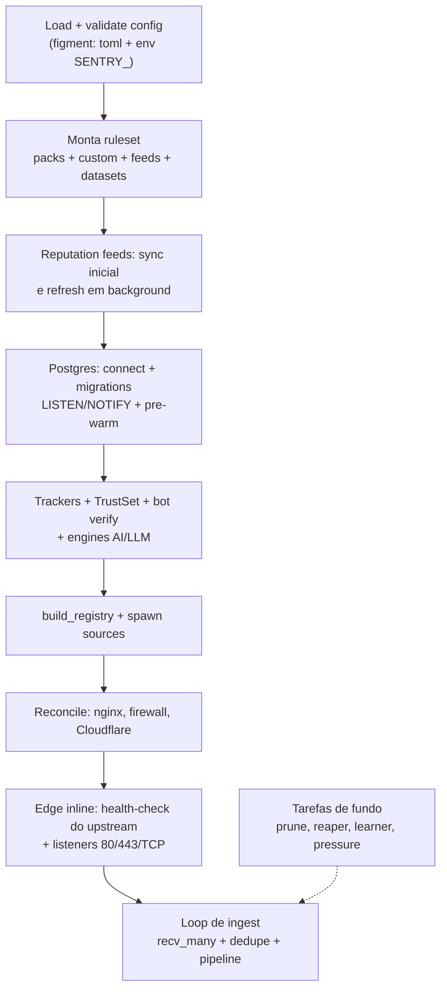

# Ciclo de Vida do Daemon

O daemon (`sentry run`, wiring em
[`daemon.rs`](https://github.com/IDjinn/sentry/blob/main/crates/sentry-cli/src/daemon.rs#L148))
monta tudo em ordem dependente: contratos primeiro, estado compartilhado
depois, fontes e tarefas de fundo por último. Falhas de infraestrutura
opcional (Postgres, geo, feeds, DNS) degradam com `warn!` em vez de abortar;
falhas de config (policy inválida, `[real_ip]` malformado, TLS sem feature)
abortam com erro legível.

## Sequência de startup

1. **Config** — `sentry.toml` + overlay `SENTRY_*`; `ActionKind` e
   `ChallengeBackend` são enums tipados, então typo em config falha no
   load. O enforcer de protocolo também compila os schemas aqui (F9,
   compile falho mantém o set anterior).
2. **Ruleset** ([`packs.rs`](https://github.com/IDjinn/sentry/blob/main/crates/sentry-core/src/packs.rs)) —
   packs default com modos `shadow`/`enforce` (params achatam para
   `<pack>__<param>`), regras `[[rules.custom]]`, uma regra sintética por
   feed com `action` e regras de datasets (`feed:<name>`).
3. **Reputation feeds** (F3.7) — sync inicial com timeout de 120 s, sumário
   no log, refresh em background; feed que falha mantém as entradas
   anteriores.
4. **Geo** ([`sentry-geo`](https://github.com/IDjinn/sentry/blob/main/crates/sentry-geo/)) —
   abre MaxMindDB; sem as bases, enriquecimento fica desligado (no-op).
5. **Postgres** ([`sentry-storage`](https://github.com/IDjinn/sentry/blob/main/crates/sentry-storage/)) —
   connect + migrations + três tarefas LISTEN (regras, blocks, datasets) +
   regras de datasets DB aplicadas + **pre-warm do block table** a partir
   de `ip_state.blocked()` e do **offender tracker** a partir dos strikes
   persistidos (reincidente pós-TTL re-bloqueia no 1º evento). Sem URL
   configurada, roda sem persistência.
6. **Trackers e guardas** — scan, behavior, upload flood, posture,
   correlação, offender ([`pipeline.rs`](https://github.com/IDjinn/sentry/blob/main/crates/sentry-core/src/pipeline.rs));
   [`TrustSet`](https://github.com/IDjinn/sentry/blob/main/crates/sentry-core/src/trust.rs)
   (ranges Cloudflare embutidos + refresh diário + presets de listas
   confiáveis); worker de verificação rDNS de bots (F7.7) fora do hot path.
7. **Rotas** — validador merges config ∪ DB (`RouteValidator::merge`);
   sem rotas configuradas, todo path gera `UnknownRoute` (warn explícito).
8. **Registry + sources** —
   [`build_registry`](https://github.com/IDjinn/sentry/blob/main/crates/sentry-cli/src/daemon.rs#L3189)
   instancia as actions (`[[action]]`) e as sources (`[[source]]`) são
   postas em spawn, publicando no fan-in.
9. **Reconcile de infraestrutura** — nginx deny includes contra `ip_state`
   (F7.8), sync de bans de kernel/firewall do DB (loop 60 s, F7.3),
   reconcile Cloudflare no startup (verifica token, adota regras vivas,
   deleta expiradas, provê IP Lists /64 — F2.5/F2.14).
10. **Edge inline** (se `mode = "inline"`) —
    [`proxy::serve`](https://github.com/IDjinn/sentry/blob/main/crates/sentry-edge/src/proxy.rs#L158)
    executa o **health-check obrigatório do upstream** antes de aceitar
    tráfego (falha o startup se o backend não responde), sobe o listener
    80, o TLS 443 (feature `edge-tls`) e o edge-tcp opcional.
11. **Servidor de métricas** — `/metrics` + `/api/events` ([`metrics.rs`](https://github.com/IDjinn/sentry/blob/main/crates/sentry-cli/src/metrics.rs))
    quando `[metrics] enabled`.
12. **Loop de ingest** — `recv_many(64)` no fan-in, dedupe LRU,
    `pipeline.process`, forks inline, lanes de telemetria/ação.

## Tarefas de fundo

| Tarefa | Intervalo | Papel |
| --- | --- | --- |
| Prune de trackers (offender, scan, behavior, upload, correlação, posture, BlockTable, rate limiter) | 60 s | Expira janelas por-IP e entradas de bloco |
| [`prune_pending`](https://github.com/IDjinn/sentry/blob/main/crates/sentry-core/src/pipeline.rs#L770) | 60 s | Descarta sinais de resposta vencidos (F3.9.1) |
| Monitor de pressão | 5 s | Occupancy de filas + latência INSERT (EMA) → liga `OverloadState` |
| Persist worker | contínuo | Lotes de até 64 eventos por multi-INSERT |
| Action workers | contínuo | Executa actions deferred (rede); 1 worker = ordem estrita |
| Cloudflare reaper | 300 s | Deleta access rules/IP List entries cujo TTL `sentry:<ts>:<ttl>` expirou |
| Route learner | `[route_learner] interval_secs` | Infere formas de rota e publica via NOTIFY |
| Refresh de ranges Cloudflare (`[real_ip]`) | diário | Atualiza o `TrustSet` |
| Protocol watcher (F9) | debounce 500 ms + safety poll 60 s | Recompila schemas em fs events |
| Refresh de feeds | por feed | Re-busca feeds de reputação/datasets |

## Hot-reload via LISTEN/NOTIFY

Estado compartilhado entre nós e entre CLI/dashboard e daemon trafega por
canais Postgres ([`PgPool`](https://github.com/IDjinn/sentry/blob/main/crates/sentry-storage/src/pool.rs)):

| Canal | Quem escuta | Efeito |
| --- | --- | --- |
| `sentry_rules_changed` | `rules_hot_reload` | Recarrega o `RuleSet` do DB e faz swap a quente |
| `sentry_blocks_changed` | `blocks_hot_reload` | Atualiza o `BlockTable` — bloco num nó nega na edge de todos |
| `sentry_datasets_changed` | `datasets_hot_reload` | Substitui regras `dataset:<name>` e literais do prefilter dinâmico (F7.7) |
| `sentry_routes_changed` | `routes_hot_reload` | Merge config ∪ DB e swap do validador (learner + `sentry routes`) |
| `sentry_model_changed` | model reload loop | Troca o ONNX a quente com o `AiFork` em `Arc<RwLock<>>` (F3.6) |

Emissores: comandos CLI (`sentry rules`, `sentry model reload`,
`sentry routes`, `sentry ip block/unblock`), o dashboard (`serve`) e o
próprio daemon (espelho de blocks).

## Encerramento

Não há dreno gracioso explícito: o loop de ingest roda enquanto houver
produtores, e o processo termina por sinal do SO (`SIGINT`/`SIGTERM`).
A durabilidade vem do design stateless-em-memória / stateful-em-Postgres:
blocks, strikes, incidentes e eventos vivem no banco e são **re-aquecidos
no próximo startup** (pre-warm do `BlockTable` e do offender tracker), de
forma que uma morte abrupta não perde postura de segurança. Tarefas de
fundo idempotentes (reaper, reconcile, learner) simplesmente recomeçam.
