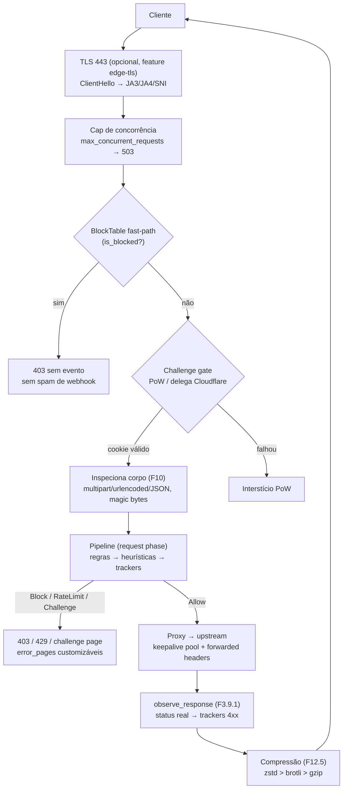

# Edge Inline

No modo `[deployment] mode = "inline"` o Sentry deixa de ser um observador
e vira o **front da aplicação**: um reverse proxy axum
([`sentry-edge/src/proxy.rs`](https://github.com/IDjinn/sentry/blob/main/crates/sentry-edge/src/proxy.rs))
que inspeciona cada request **antes** do upstream e aplica o verdict na
hora. O proxy roda o mesmo `Arc<Pipeline>` das sources passivas (trackers
não duplo-contam) e entrega eventos prontos (`Incoming::Processed`) ao
daemon.

## Health-check obrigatório e proxy reverso

O startup falha se o upstream não responde ao health-check
(`health_path`, default `/`, timeout `health_timeout_secs` = 5 s) — a edge
nunca sobe "protegendo" um backend morto. O hop edge→upstream é tunado
(F12.6): `connect_timeout` 5 s, pool de keepalive com
`upstream_pool_idle` = 32 conexões por host (idle 90 s, TCP keepalive 60 s)
e `tcp_nodelay` — **zero handshake TCP por request** no hop interno.

## Fast-path de bloqueio (BlockTable)

O [`BlockTable`](https://github.com/IDjinn/sentry/blob/main/crates/sentry-core/src/blocks.rs)
é um `HashMap<IpAddr, Option<Instant>>` compartilhado. A edge (proxy,
middleware, edge-tcp e o aceitor TLS) consulta `is_blocked` **antes** de
qualquer processamento: IP bloqueado leva 403 imediato, sem evento e sem
passar pelo pipeline — sem spam de webhook e com custo O(1).

- Verdicts Block do pipeline são espelhados no `ip_state` (Postgres) com
  `NOTIFY sentry_blocks_changed`; pre-warm no startup e LISTEN por nó
  fazem um bloco aplicado em qualquer nó valer na edge de todos
  ([`daemon.rs`](https://github.com/IDjinn/sentry/blob/main/crates/sentry-cli/src/daemon.rs)).
- Guard never-ban (`[real_ip] trusted_ips`) vale também no fast-path.
- Métricas: `sentry_edge_block_hits_total`, `sentry_block_table_size`.

## Verdict → HTTP

| Verdict | Resposta |
| --- | --- |
| Block | 403 (página customizável) |
| RateLimit | 429 com `Retry-After` |
| Challenge | interstício PoW (backend `sentry`) ou regra Cloudflare (backend `cloudflare`) |
| Allow | proxy para o upstream |

Todas as páginas geradas pela edge (403/429/challenge/413/502/301) passam
pelo mapa [`ErrorPages`](https://github.com/IDjinn/sentry/blob/main/crates/sentry-edge/src/pages.rs)
(F12.1): `[edge.error_pages] dir` com `<status>.html` + `default.html`,
UTF-8, cap 256 KiB/arquivo, placeholders `{{SENTRY_STATUS}}`,
`{{SENTRY_TITLE}}`, `{{SENTRY_MESSAGE}}`, `{{SENTRY_TRACE_ID}}`,
`{{SENTRY_ICON}}` com escape de HTML. Trace ID sempre (header
`x-sentry-trace-id` + log).

## JS challenge com proof-of-work (F7.11)

`[edge.challenge] enabled = true` troca a resposta de Challenge por um
interstício PoW SHA-256 stateless
([`challenge.rs`](https://github.com/IDjinn/sentry/blob/main/crates/sentry-edge/src/challenge.rs)):

- `challenge_id = SHA-256(secret || ip || bucket)`; buckets de
  `bucket_secs` (default 3600) com graça de 1 bucket — o cookie
  `sentry_ch` sobrevive à rotação.
- Secret via env (`secret_env`, default `SENTRY_EDGE_CHALLENGE_SECRET`) —
  obrigatório quando enabled; compartilhe entre nós da edge.
- `difficulty` default 16; página sem CDN, `template_path` opcional com
  hot-read.
- PoW nunca destrava Block; respostas 503 com `Retry-After`.
- Crawlers verificados por rDNS (F7.7) passam sem resolver.

## TLS inline com telemetria ClientHello (F8)

Feature `edge-tls` ([`tls.rs`](https://github.com/IDjinn/sentry/blob/main/crates/sentry-edge/src/tls.rs)):
o aceitor faz *peek* do ClientHello **antes** do handshake rustls, parseia
SNI/ciphers/extensions ([`clienthello.rs`](https://github.com/IDjinn/sentry/blob/main/crates/sentry-edge/src/clienthello.rs))
e alimenta o pipeline com um evento `TlsHandshake` (SNI + JA3 + JA4) por
conexão. O fast-path do BlockTable nega antes do handshake.

- ALPN `h2` + `http/1.1` com HTTP/2 servido no mesmo router
  (`[edge] http2`, default true); métrica `sentry_edge_tls_alpn_total{alpn}`.
- `tls_allowed_hosts` — SNI ausente/desconhecido (honeypot 443) vira o
  sinal `TlsSniMismatch` (peso 20); Block/Quarantine pós-handshake derrubam
  a conexão.
- `tls_redirect_https` responde 301 na porta 80 **depois** do pipeline —
  o tráfego HTTP continua monitorado e bloqueado.
- Gauge `sentry_edge_tls_cert_not_after` com warn quando o certificado
  expira em menos de 14 dias.

## Inspeção de uploads e corpo (F10)

`[uploads] enabled = true` (opt-in, requer inline) liga a análise do corpo
antes do proxy: multipart RFC 7578, urlencoded e JSON
([`multipart.rs`](https://github.com/IDjinn/sentry/blob/main/crates/sentry-core/src/multipart.rs),
[`uploads.rs`](https://github.com/IDjinn/sentry/blob/main/crates/sentry-core/src/uploads.rs)).

- `inspect_kb` (default 4096 = 4 MiB) limita o buffer por request; o teto
  de memória é ~concorrência × `inspect_kb` — por isso existe o cap de
  concorrência.
- Corpo maior que o cap segue a política `oversize`: `reject` (413),
  `skip` (encaminha sem parse) ou `flag` (encaminha + sinal
  `UploadOversize` peso 20 + conta na janela de flood).
- Sinais: `UploadTypeMismatch` (30), `UploadPolyglot` (60),
  `UploadExecutable` (50), `UploadFlood` (25), `UploadDisallowed` (30,
  allowlist `allowed_extensions`). `mode = "shadow"` zera os pesos —
  detecta sem bloquear.
- SQLi/XSS em filenames e campos de formulário reemitem os sinais HTTP
  conhecidos, então dashboards e regras existentes funcionam de graça.

## Postura de segurança web (F11)

[`posture.rs`](https://github.com/IDjinn/sentry/blob/main/crates/sentry-core/src/posture.rs)
avalia os headers da **resposta do upstream** (nunca de páginas geradas
pela edge) e anexa findings `PostureAdvisory` com **peso 0 travado**:
`csp`, `hsts`, `coop`, `clickjacking`, `trusted_types`, `nosniff`,
`referrer_policy` — todos desligáveis em `[posture] checks`. Dedupe por
(host, check) com TTL 1 h, cap de 64 hosts. Métrica
`sentry_posture_findings_total{check, host}`; relatório via
`sentry posture`. `mode = "enforce"` é rejeitado no load (injeção de
headers é roadmap).

## Compressão de resposta (F12.5)

[`compression.rs`](https://github.com/IDjinn/sentry/blob/main/crates/sentry-edge/src/compression.rs) —
um middleware cobre upstream e páginas da edge nos dois listeners. Corpos
já bufferizados → re-encode síncrono com `content-length` exato.

- Negociação de `Accept-Encoding` com preferência **zstd > brotli > gzip**
  (zstd atrás da feature `edge-zstd`; brotli/gzip são pure-Rust e sempre
  presentes). Níveis: `level_br` 4, `level_gzip` 6, `level_zstd` 3.
- Nunca comprimido: `content-encoding` presente, 206/`content-range`,
  `no-transform`, corpo menor que `min_length` (256), content-type fora da
  allowlist (semântica `gzip_types`; `text/event-stream` excluído) e
  payload que não encolhe. `Vary: Accept-Encoding` sempre em candidatos.
- Sob overload (flag compartilhada `OverloadState`) a compressão se
  desliga sozinha. Métrica `sentry_edge_compressed_total{algo}`.

## Forwarded headers e hop de upstream (F12.6/7)

`[edge] forwarded_headers = true` (default): a edge remove
`X-Forwarded-*`/`X-Real-IP` do cliente e seta a visão resolvida —
`X-Forwarded-For`/`X-Real-IP` = IP do cliente (precedência §8.1),
`X-Forwarded-Proto` = scheme real (via extensão `TlsTerminated`, nunca um
header spoofável), `X-Forwarded-Host` = Host original. O backend nginx
mantém `real_ip`/vhost funcionando sem spoof. Advisories de topologia
(`edge_advisories()`): TLS duplo com upstream `https://` e hop sem
criptografia para upstream fora do loopback.

## Cap de concorrência

`[edge] max_concurrent_requests` (default **1024**, 0 = ilimitado): cada
request em voo bufferiza até o cap de inspeção/forward em memória, então
uma enchente de conexões multiplica esse custo. Além do cap, o request
recebe 503 imediato (com error pages customizáveis) em vez de ser
bufferizado — memória bounded por design.
