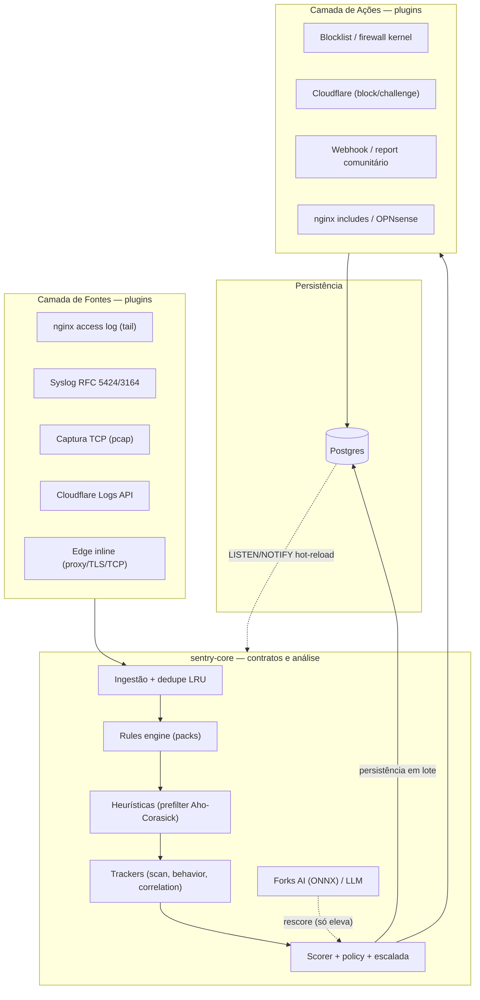

# Arquitetura de Alto Nível

O Sentry é um workspace Cargo organizado em **três camadas de plugins**
(Sources, Core, Actions) sobre uma camada de persistência Postgres. Fontes
produzem eventos normalizados; o core analisa e decide; actions executam a
decisão. Todo plugin implementa um trait comum, então novas fontes e ações
não exigem mudar o core.

## Princípios de design

1. **Event modular via `ProtocolData`**: um único [`Event`](https://github.com/IDjinn/sentry/blob/main/crates/sentry-core/src/event.rs) independente da origem. O que é específico de protocolo vive no enum [`ProtocolData`](https://github.com/IDjinn/sentry/blob/main/crates/sentry-core/src/event.rs#L396) — nunca em campos soltos no top-level.
2. **Plugins dependem só do core**: toda crate `sentry-source-*` / `sentry-action-*` implementa os traits [`Source`](https://github.com/IDjinn/sentry/blob/main/crates/sentry-core/src/source.rs) / [`Action`](https://github.com/IDjinn/sentry/blob/main/crates/sentry-core/src/action.rs) e depende apenas de `sentry-core`, nunca de outra plugin.
3. **Core puro**: `sentry-core` não faz I/O pesado (sem HTTP, sem DB). Ele define contratos — regras, heurísticas, scorer, trackers e pipeline.
4. **Edge actions provider-agnostic**: o trait [`ChallengeProvider`](https://github.com/IDjinn/sentry/blob/main/crates/sentry-core/src/challenge.rs) espelha o `LlmProvider`; o filtro de verdict fica no core, o provider só implementa `apply`. Adicionar AWS WAF/Fastly não muda regras nem pipeline.
5. **Features pesadas são opcionais**: ONNX (`onnx`), TLS (`edge-tls`), zstd (`edge-zstd`), pcap, redis ficam atrás de feature flags desligadas por default.
6. **Configuração declarativa**: `sentry.toml` + overlay de env (`SENTRY_*`) via figment, validada em tempo de carga (erros de digitação em `type = "..."` falham no load).

## Mapa de crates (workspace)

| Crate | Propósito |
| --- | --- |
| [`sentry-core`](https://github.com/IDjinn/sentry/blob/main/crates/sentry-core/) | Pura: `Event`/`ProtocolData`, traits, rules engine + DSL, heurísticas, scorer, trackers (scan/behavior/correlation/offender), pipeline, config, posture, botverify, BlockTable |
| [`sentry-storage`](https://github.com/IDjinn/sentry/blob/main/crates/sentry-storage/) | Postgres via sqlx: 5 repos (events/incidents/ip_state/rules/routes), migrations, `LISTEN/NOTIFY` |
| [`sentry-ai`](https://github.com/IDjinn/sentry/blob/main/crates/sentry-ai/) | Trait `ThreatModel` (ONNX via ort) + trait `LlmProvider` (OpenRouter, Ollama, …) + lookup externo de IP |
| [`sentry-geo`](https://github.com/IDjinn/sentry/blob/main/crates/sentry-geo/) | Enriquecimento geo/ASN com maxminddb (no-op gracioso sem as bases) |
| [`sentry-reputation`](https://github.com/IDjinn/sentry/blob/main/crates/sentry-reputation/) | Feeds de reputação (Tor/Spamhaus/FireHOL) com fetcher guardado contra SSRF |
| [`sentry-protocol`](https://github.com/IDjinn/sentry/blob/main/crates/sentry-protocol/) | DSL de descrição/validação de protocolos (F9): schema → compilador → VM (feature `simd` opcional) |
| [`sentry-edge`](https://github.com/IDjinn/sentry/blob/main/crates/sentry-edge/) | Edge inline: reverse proxy axum, edge-tcp, TLS 443 com telemetria JA3/JA4 (F8), challenge PoW, compressão, error pages |
| [`sentry-source-nginx`](https://github.com/IDjinn/sentry/blob/main/crates/sentry-source-nginx/) | Plugin Source: tail de access.log com resolução de IP real (§8.1) e rotação |
| [`sentry-source-syslog`](https://github.com/IDjinn/sentry/blob/main/crates/sentry-source-syslog/) | Plugin Source: receptor syslog RFC 5424/3164 (UDP/TCP, framing RFC 6587) |
| [`sentry-source-cloudflare`](https://github.com/IDjinn/sentry/blob/main/crates/sentry-source-cloudflare/) | Plugin Source: polling da CF Logs API (NDJSON), dedupe por RayID |
| [`sentry-source-tcp`](https://github.com/IDjinn/sentry/blob/main/crates/sentry-source-tcp/) | Plugin Source: captura TCP atrás da feature `pcap`; fingerprint SYN estilo MuonFP/p0f fica no core (`tcpfp.rs`) |
| [`sentry-action-cloudflare`](https://github.com/IDjinn/sentry/blob/main/crates/sentry-action-cloudflare/) | Action edge: block/challenge via API CF (access rules + IP Lists /64), reconcile e reaper |
| [`sentry-action-webhook`](https://github.com/IDjinn/sentry/blob/main/crates/sentry-action-webhook/) | Action: alertas Discord/Slack/etc com assinatura HMAC |
| [`sentry-action-blocklist`](https://github.com/IDjinn/sentry/blob/main/crates/sentry-action-blocklist/) | Action: blocklist local em memória (espelha no `BlockTable` compartilhado) |
| [`sentry-action-firewall`](https://github.com/IDjinn/sentry/blob/main/crates/sentry-action-firewall/) | Action: bans de kernel nftables/ipset/firewalld com sync do `ip_state` (Linux-only) |
| [`sentry-action-opnsense`](https://github.com/IDjinn/sentry/blob/main/crates/sentry-action-opnsense/) | Action: bans OPNsense (alias_util REST) e pfSense (`pfctl`) |
| [`sentry-action-nginx`](https://github.com/IDjinn/sentry/blob/main/crates/sentry-action-nginx/) | Action: includes deny/challenge para nginx + reload com `nginx -t` |
| [`sentry-action-report`](https://github.com/IDjinn/sentry/blob/main/crates/sentry-action-report/) | Action: report comunitário AbuseIPDB/ReportedIP com dedupe e circuit breaker |
| [`sentry-cli`](https://github.com/IDjinn/sentry/blob/main/crates/sentry-cli/) | Binário: daemon + wiring, servidor HTTP (`serve`), TUI ratatui, auth/RBAC, export SIEM, service mode, comandos CLI |

## Convenções de workspace

- Deps compartilhadas ficam em `[workspace.dependencies]` no `Cargo.toml`
  raiz; cada crate referencia via `{ workspace = true }`.
- `sentry-core` é **pure** (`#![forbid(unsafe_code)]` em todas as libs) —
  sem I/O de rede ou banco; quem integra é o daemon (`sentry-cli`).
- Ao adicionar um novo protocolo: nova variante em `ProtocolData` + helper
  em `impl Event` + atualização de `protocol_kind()`. Detalhes na página
  [Modelo de Dados](/pt/architecture/data-model).
- Ao adicionar um novo provider de edge (AWS WAF, Fastly…): nova crate
  implementando `ChallengeProvider` + braço no `match` de
  `build_challenge_action` no daemon — sem mudar `ActionKind`, regras ou
  pipeline.

## Próximos passos

- [Modelo de Dados](/pt/architecture/data-model) — `Event`, `ProtocolData`, `UploadInfo`
- [Fluxo de uma Requisição](/pt/architecture/request-flow) — pipeline em ordem, dos dois modos de ingestão
- [Níveis de Risco](/pt/architecture/risk-levels) — pesos de sinais, vereditos, escalada
- [Ciclo de Vida do Daemon](/pt/architecture/daemon-lifecycle) — startup, tarefas de fundo, hot-reload
- [Edge Inline](/pt/architecture/edge-inline) — proxy, TLS, challenge, uploads, compressão
- [Performance](/pt/architecture/performance) — números de benchmark, two-lane hot path, overload
