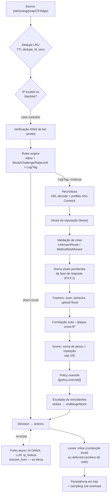
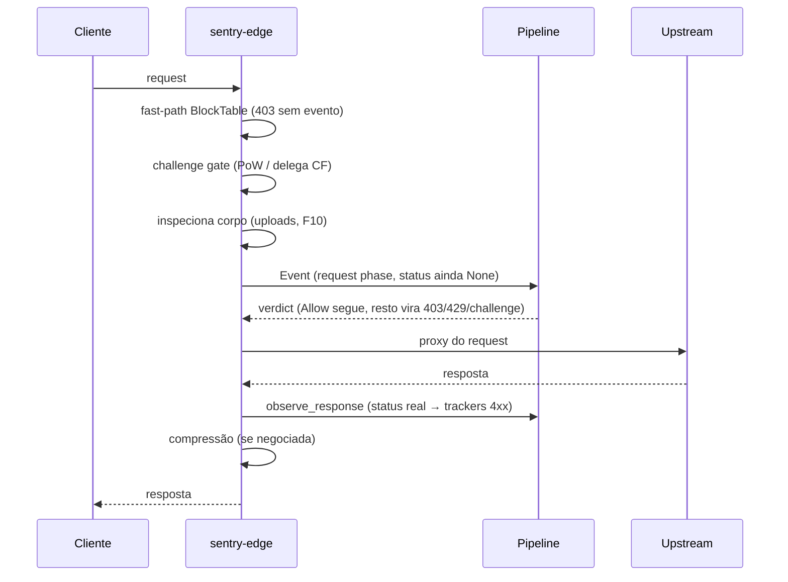

# Fluxo de uma Requisição

O Sentry opera em dois modos de ingestão, definidos em
`[deployment] mode`:

- **Passivo** (default): sources read-only fazem tail de logs / recebem
  syslog / capturam pacotes. O pipeline analisa o evento e as actions
  reagem (block no Cloudflare/firewall, webhook, …) — a requisição já
  aconteceu.
- **Inline** (`sentry-edge`): o Sentry é o reverse proxy na frente da
  aplicação. O request passa pelo **mesmo** `Arc<Pipeline>` **antes** do
  upstream; o verdict decide se ele segue (e a fase de resposta é
  re-observada — ver abaixo).

## Estágios em detalhe

1. **Ingest + dedupe** — o loop do daemon drena o fan-in em lote
   (`recv_many(64)`) e consulta uma LRU por hash `u64` do evento; GETs
   idênticos dentro de `dedupe_ttl_secs` (10 s) morrem antes do pipeline.
   Veja [`daemon.rs`](https://github.com/IDjinn/sentry/blob/main/crates/sentry-cli/src/daemon.rs).
2. **Guardas de confiança** ([`trust.rs`](https://github.com/IDjinn/sentry/blob/main/crates/sentry-core/src/trust.rs)) —
   IPs em `trusted_ips` (never-ban) recebem Allow imediato; IPs na
   `blacklist` levam Block antes de qualquer detector.
3. **Bot verification** ([`botverify.rs`](https://github.com/IDjinn/sentry/blob/main/crates/sentry-core/src/botverify.rs), F7.7) —
   UA que alega crawler é anotado com o resultado cacheado do rDNS
   (verificado → bypass de challenge; falsificado → sinal `SpoofedBot`).
4. **Rules engine** ([`rules.rs`](https://github.com/IDjinn/sentry/blob/main/crates/sentry-core/src/rules.rs), [`packs.rs`](https://github.com/IDjinn/sentry/blob/main/crates/sentry-core/src/packs.rs)) —
   fast path. Precedência: `Allow` (bypass total) > `Block`/`Challenge`/
   `RateLimit` (short-circuit) > `Log`/`Tag` (anota e continua). Packs
   default: `sensitive_paths`, `crawlers_bad`,
   `crawlers_good`, `empty_ua`, `http_anomaly`, `vpn_proxy`, `tor`,
   `rate_scan`, `country_blocklist`, `host_allowlist`.
5. **Heurísticas** ([`heuristics.rs`](https://github.com/IDjinn/sentry/blob/main/crates/sentry-core/src/heuristics.rs)) —
   SQLi/XSS/path traversal/LFI/Log4Shell/cmd injection/sensitive path/bad
   crawler/UA vazio + scanners de upload (F10). Rodam sobre texto
   URL-decodificado (`http_text`) com prefilter Aho-Corasick: tráfego
   limpo executa **zero regex**.
6. **Reputação** ([`reputation.rs`](https://github.com/IDjinn/sentry/blob/main/crates/sentry-core/src/reputation.rs)) —
   `TorExitNode`, `KnownBadIp`, `VpnProxy`, `PromiscuousScanner` a partir
   das feeds sincronizadas (F3.7).
7. **Rotas** (validador em
   [`pipeline.rs`](https://github.com/IDjinn/sentry/blob/main/crates/sentry-core/src/pipeline.rs)) —
   path fora da allowlist (config ∪ DB) → `UnknownRoute`; método não
   permitido → `MethodNotAllowed`. Suporta exato, glob `/api/*` e
   templates `/users/{id}`.
8. **Fase de resposta** (F3.9.1) — sinais que dependem do status HTTP
   (janelas 4xx) só existem depois da resposta. Na edge inline,
   [`Pipeline::observe_response`](https://github.com/IDjinn/sentry/blob/main/crates/sentry-core/src/pipeline.rs#L737)
   alimenta os trackers com o status real (upstream ou 403/429/301 da
   própria edge) e enfileira os sinais (TTL 60 s, cap 16/IP); o próximo
   request do mesmo IP os drena para o scoring. Sem isso, scanners em
   tráfego inline ficariam para sempre em Allow.
9. **Trackers de comportamento** —
   [`ScanTracker`](https://github.com/IDjinn/sentry/blob/main/crates/sentry-core/src/scan.rs)
   (≥ 8 paths 4xx distintos → `RandomScan`; ≥ 10 4xx → `ScanBehavior`),
   [`BehaviorTracker`](https://github.com/IDjinn/sentry/blob/main/crates/sentry-core/src/behavior.rs)
   (auth brute-force, credential stuffing, directory brute-force,
   suspicious login success) e
   [`UploadTracker`](https://github.com/IDjinn/sentry/blob/main/crates/sentry-core/src/uploads.rs)
   (flood de volume, F10).
10. **Correlação** ([`correlation.rs`](https://github.com/IDjinn/sentry/blob/main/crates/sentry-core/src/correlation.rs), F3.10) —
    scan de um IP + ataque de **outro** IP no mesmo /24, /64 ou ASN dentro
    da janela → `ScanAttackCorrelation`.
11. **Scorer + policy + escalada** — soma dos pesos (cap 100) com bônus de
    repetição, [`VerdictPolicy`](https://github.com/IDjinn/sentry/blob/main/crates/sentry-core/src/policy.rs)
    (mapping nível→verdict + overrides DSL) e
    [`OffenderTracker`](https://github.com/IDjinn/sentry/blob/main/crates/sentry-core/src/offender.rs)
    (strikes sobem o verdict). Detalhes em
    [Níveis de Risco](/pt/architecture/risk-levels).
12. **Forks assíncronos** — modelo ONNX, LLM e lookup externo de IP rodam
    fora do caminho quente e re-entram por
    [`rescore_from`](https://github.com/IDjinn/sentry/blob/main/crates/sentry-core/src/pipeline.rs#L1005):
    **só elevam** score/verdict, nunca rebaixam. IPs never-ban são
    imunes.
13. **Actions em duas lanes** (F5) — contenção local (blocklist, log,
    firewall) roda inline no loop de ingest; actions de rede (Cloudflare,
    nginx, OPNsense, webhook, report) vão para workers postergados. Sob
    overload a fila de actions enche primeiro: caem **actions**, nunca
    eventos (`sentry_action_queue_drops_total`).
14. **Persistência** — worker dedicado escreve em lote (um multi-INSERT
    por `recv_many`); eventos de segurança caem para escrita direta se a
    fila encher; eventos benignos são coalescidos/amostrados sob pressão.
    Ver [Performance](/pt/architecture/performance).

## Edge inline: o que muda

No modo inline o request entra pela edge **antes** do upstream:

- Verdicts de contenção são espelhados no `ip_state` + `NOTIFY
  sentry_blocks_changed`, então o fast-path nega o IP **antes** do
  pipeline em todos os nós.
- Eventos chegam ao fan-in como `Incoming::Processed` (verdict pronto);
  o daemon só persiste e despacha actions.
- Detalhes completos (TLS, challenge, error pages, compressão) em
  [Edge Inline](/pt/architecture/edge-inline).
